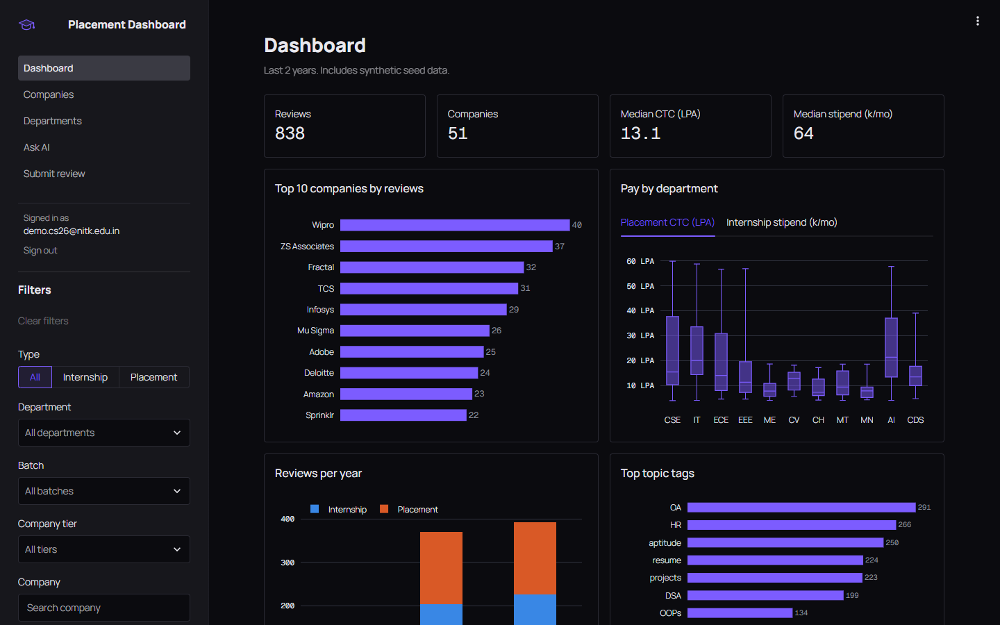
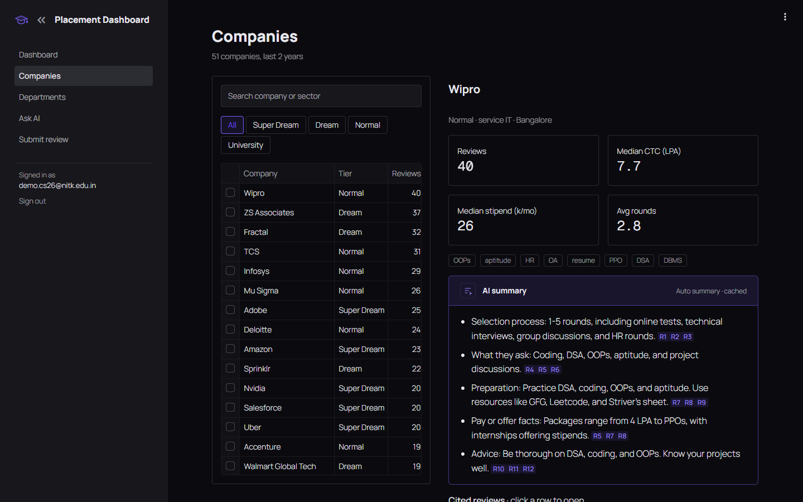
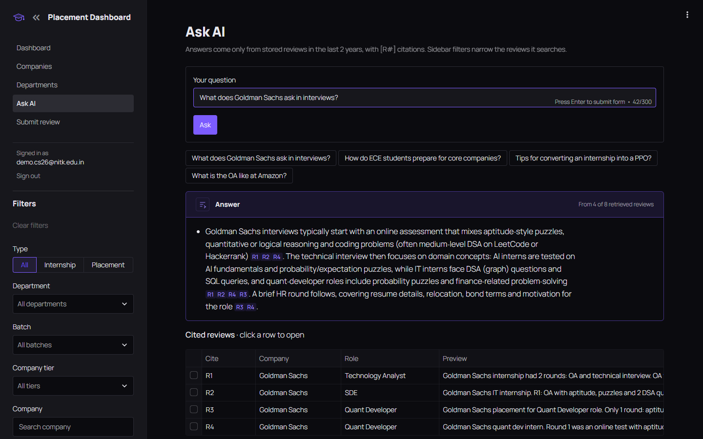
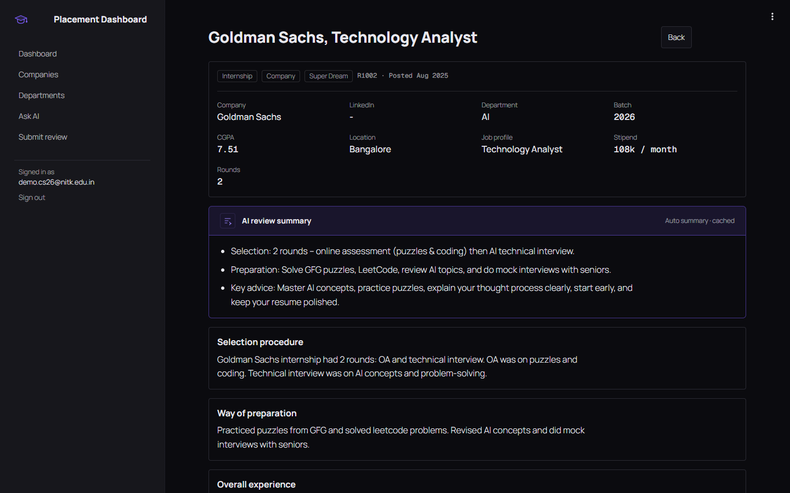

<p align="center">
  
</p>

# Placement Dashboard

*Every senior's interview, one search away.*

<p align="center">
  <a href="#run"></a>
  <a href="https://streamlit.io/"></a>
  <a href="#how-the-ai-stays-honest"></a>
  <a href="#tests"></a>
  <a href="#data"></a>
</p>

---

## What it is

A placement and internship review board for NITK B.Tech students. Seniors post how their interviews went; juniors browse stats, read company and department overviews, and ask questions that an AI answers **only from those reviews**, with a citation on every claim.

<p align="center">
  
</p>

## Features

- **Dashboard:** KPIs, top companies, pay by department, reviews per year, topic tags. Six sidebar filters (type, department, batch, tier, company, CGPA).
- **Company and department overviews:** stats, tags, an AI summary where every bullet cites its reviews, newest reviews with a preview.
- **Ask AI:** plain-English questions, answers in under 120 words with `[R#]` citations, or an honest "not enough in the reviews".
- **Review page:** details, a 3-line AI summary, then the full write-up.
- **Submit review:** grouped form with validation; a new review updates the dashboard immediately.
- **Light and dark** themes, NITK email login, 2-year data window.

| Company overview | Ask AI |
|---|---|
|  |  |

<p align="center">
  
</p>

## How the AI stays honest

```
question ──► SQLite FTS5 (BM25) top 8 reviews, last 2 years, sidebar filters
         ──► names, emails, phones, LinkedIn stripped; each review fenced as data
         ──► LLM (via OmniRoute) answers from the reviews only
         ──► every [R#] must be a retrieved review ──► else retry, then next model
```

Instructions hidden inside a review ("ignore previous instructions...") are treated as text, not commands. Overviews are cached in SQLite, so an unchanged page costs zero AI calls.

## Run

**One click:** double-click `run.bat`. On first run it makes `.venv`, installs requirements and opens `.env` for your key. It starts OmniRoute if it is installed, then opens the app at http://localhost:8501.

**By hand:**

```bash
git clone https://github.com/saijishnup/AI-powered-Placement-Dashboard.git
cd AI-powered-Placement-Dashboard
python -m venv .venv
.venv\Scripts\python -m pip install -r requirements.txt
copy .env.example .env          # then paste your API key into LLM_API_KEY
.venv\Scripts\python -m streamlit run app.py
```

Log in with any `@nitk.edu.in` address. Charts, tables and cached summaries work without a key; Ask AI and new summaries need one. `LLM_BASE_URL` takes any OpenAI-compatible endpoint (OmniRoute, OpenRouter, Groq).

## Tests

| Command | Does |
|---|---|
| `.venv\Scripts\python -m pytest -q` | 25 tests: 2-year window, FTS search, PII scrub, citation checks, stats block, typo company match, prompt-leak guard, model fallback, prompt injection, cache, every page renders. No network. |

## Data

1,560 **synthetic** reviews (51 companies, 11 departments, 2023–2026) written by AI models in the style of real student reviews. No real names or links. Lives in `data/reviews.db`; the source JSON is in `seed/`.

## Layout

| Path | What |
|---|---|
| `app.py` | Login and navigation |
| `pages/` | Dashboard, Companies + Departments (`overview.py`), Ask AI, Review, Submit |
| `lib/db.py` | SQLite schema, filters, 2-year window, FTS search, cache |
| `lib/qa.py`, `lib/llm.py`, `lib/pii.py` | Retrieval, prompts, citation checks, model fallback, PII scrub |
| `lib/ui.py` | Theme CSS, charts, shared widgets |

## Future work

Google sign-in, admin approval of reviews, reporting, company alias merge, rate limiting.
